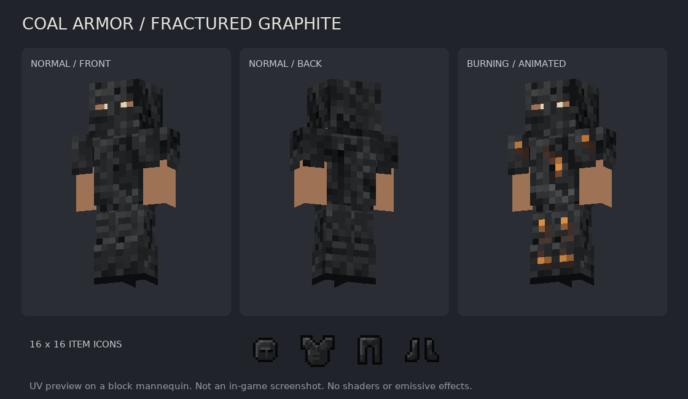

# Угольная броня — Minecraft 1.21.1 / NeoForge

Исходники мода **Coal Armor** (`coal_armor`), рецепты, текстуры и настройка сборки.
Требуются **Minecraft 1.21.1**, **NeoForge 21.1.176+ ветки 21.1** и **Java 21**.
Мод нужно установить и на сервер, и на клиенты.

> **Статус проверки:** ресурсы проверены локально. Компиляция и запуск Minecraft в этой
> среде не выполнены: нет Java 21, а серверы зависимостей Gradle/NeoForge/Mojang недоступны.
> Готового игрового JAR в репозитории пока нет. Настроена сборка через GitHub Actions;
> первый успешный запуск workflow подтвердит компиляцию, но не заменит проверку в игре.

## Обновлённые текстуры



[Открыть анимацию отдельно](docs/coal_armor_preview.gif) ·
[Статичная картинка](docs/coal_armor_preview.png)

Это программный предпросмотр настоящих UV-текстур на блочном манекене, не скриншот игры.
Текстуры сохраняют ванильный масштаб: 64×32 для брони, 16×16 для иконок.
У каждой поверхности свой рисунок угольных изломов: неровные пласты, короткие трещины,
приглушённые графитовые блики, сколы у свободных краёв. Повторяющиеся диагональные
полосы удалены. Без фотореалистичного шума, сглаживания и случайных прозрачных дыр.
Закрытый шлем сохраняет глазные прорези и носовую перемычку.

### Переливы при горении

Вместо статичной подмены на оранжевую броню — **48 кадров по 2 игровых тика**
(10 кадров/с, бесшовный цикл **4,8 секунды** при 20 TPS). По угольным граням скользит
графитовый блик, а вдоль тонких трещин проходят неодновременные импульсы тления:
от тёмно-медного к небольшим золотистым горячим точкам. Основная фактура остаётся
на месте; силуэт и прозрачность глаз не меняются. Оба слоя работают в одной фазе.

Кадр выбирается в `CoalArmorItem.getArmorTexture` по времени мира. Пути ресурсов
кэшируются один раз; нет загрузки файлов или генерации картинок во время рендеринга.
Самостоятельные текстуры брони не являются спрайтами атласа блоков/предметов, поэтому
для них намеренно **не используется неработающий здесь `.png.mcmeta`**.
Анимация останавливается на паузе мира и исчезает при тушении/неполном комплекте.
Дополнительные шейдеры и моды не нужны. Это цветовая анимация, не динамическое
освещение мира и не отдельный fullbright-слой. В игре эффект ещё нужно проверить.
GIF использует те же кадры и длительность, что и код мода, и показывает горение
**спереди, сзади и сбоку** одновременно. Жилы распределены отдельно по затылку,
боковинам шлема, груди, спине, бокам корпуса, всем сторонам рукавов, поножей и ботинок.
На больших поверхностях несколько разнесённых очагов, на узких — короткие жилы.
Импульсы достигают пика в разное время, сохраняя между собой тёмную угольную фактуру.
Основное тление поножей расположено выше ботинок, чтобы его не закрывал внешний слой.

Перегенерация и проверки (нужен `python3 -m pip install Pillow`):

```bash
python3 tools/generate_textures.py
python3 tools/preview_textures.py
python3 tools/test_textures.py
```

## Механики

Все особые эффекты и недостатки действуют **только при надетых четырёх элементах**.
После снятия или поломки элемента обычные правила игры возвращаются.

- **Защита:** входящий урон, кроме огненного и взрывов TNT (включая вагонетку с TNT),
  отменяется. Каждая деталь теряет `max(1, floor(входящий урон / 4))` прочности.
  «Прочность» учитывается; поломка элемента прекращает бонус полного комплекта.
- **Огонь:** огонь, горение, лава, костры, магмовые блоки и огненные снаряды наносят
  удвоенный входящий огненный урон. Затем применяются обычные игровые модификаторы,
  например «Огнеупорность». TNT проходит сквозь иммунитет, но его урон не удваивается.
  Поджог зачарованным оружием или стрелами также запускает постоянное горение.
- **Постоянное горение:** вода, дождь, снег и обычные способы тушения не помогают.
  Горение сохраняется при выходе из мира и повторном входе.
  Другой игрок может поджечь носителя ПКМ огнивом (тратится 1 прочность).
- **Ведро:** другой игрок тушит носителя ПКМ ведром воды. В выживании остаётся пустое
  ведро, в творческом режиме вода не тратится. Вода блоком при этом не размещается.
- **Пузырьки воды:** взрывной или оседающий пузырёк даёт шанс потушиться, если на
  броне есть «Огнеупорность» (Fire Protection). Источник броска не важен: сам игрок,
  другой игрок или раздатчик. Формула: **10% × сумма уровней на четырёх деталях**,
  максимум 100%. Например, I на одной детали — 10%, IV на одной — 40%,
  IV на двух — 80%, IV на трёх или четырёх — 100%.
  При неудаче ванильное тушение не обходит проверку.
- **Оседающее облако воды:** видимое облако с начальным радиусом 3 блока постепенно
  сужается за 30 секунд. После задержки 10 тиков даёт новую попытку раз в секунду.
  При разбитии пузырька также есть начальная попытка, как у взрывного.
- **Вода:** комплект поддерживает ноги у поверхности, блокирует силу течения и
  погружение при приседании/плавании. Если надеть его уже на глубине, носитель
  поднимается к поверхности, но не проходит через твёрдый потолок.
- **Внешний вид:** тёмная угольная текстура с неровными краями; у шлема закрытое лицо,
  прорези для глаз и носовая перемычка. При горении проигрываются графитовые переливы
  и импульсы тления в трещинах. Эффект — анимированная текстура, не освещение мира.

Без полного комплекта детали дают обычные характеристики брони. Суммарная защита —
**18**, между железной (**15**) и алмазной (**20**); твёрдость — **1**.
Для стандартных зачарований добавлены ванильные теги предметов по слотам.
Несовместимости зачарований остаются ванильными.

## Предметы и крафт

Крафт из **обычного угля**, не древесного, по стандартным шаблонам брони.
Починка углём на наковальне. Предметы доступны во вкладке сражения.

| Предмет | ID | Защита | Прочность (как золото) | Уголь | Топливо, тики |
|---|---|---:|---:|---:|---:|
| Шлем | `coal_armor:coal_helmet` | 2 | 77 | 5 | 8000 |
| Нагрудник | `coal_armor:coal_chestplate` | 7 | 112 | 8 | 12800 |
| Поножи | `coal_armor:coal_leggings` | 6 | 105 | 7 | 11200 |
| Ботинки | `coal_armor:coal_boots` | 3 | 91 | 4 | 6400 |

Один уголь соответствует 1600 тикам топлива. Повреждённые детали дают то же время.

## Сборка и установка

На компьютере с **JDK 21** и доступом к серверам зависимостей:

```bash
./gradlew build --no-daemon
```

В Windows: `gradlew.bat build --no-daemon`.
Готовый файл: **`build/libs/coal_armor-1.0.0.jar`**.
Положите его в папку `mods` профиля Minecraft 1.21.1 с NeoForge.
Не используйте архив исходников или `gradle-wrapper.jar` как игровой мод.

### GitHub Actions

Workflow [Build mod jar](.github/workflows/build.yml) запускается после push в `main`
или `arena/*`, для pull request и вручную. Эти файлы сами по себе workflow не запускают:
сначала их нужно отправить в GitHub. После успешной сборки скачайте артефакт
**`coal-armor-jar`** во вкладке **Actions** и извлеките игровой JAR из ZIP.

## Проверки

```bash
python3 tools/validate_resources.py
```

Это проверки JSON, рецептов, ссылок на текстуры, локализаций, тегов, mixin-конфига и
Gradle Wrapper, **не компиляция Java и не тесты игровых механик**.
Сценарии ручной проверки: [TESTING.md](TESTING.md).

## Структура проекта

- `src/main/java/com/coalarmor/` — регистрация предметов, материал и игровые события.
- `src/main/java/com/coalarmor/mixin/EntityMixin.java` — запрет неразрешённого тушения
  и отключение водного течения в момент вычисления силы.
- `src/main/resources/` — метаданные NeoForge, mixin-конфиг, рецепты, теги,
  модели предметов, текстуры брони/иконок, `ru_ru` и `en_us`.
- `tools/generate_textures.py` — воспроизводимый генератор текстур (Python + Pillow).
- `.github/workflows/build.yml` — сборка JDK 21 и загрузка JAR в артефакты.

Лицензия исходников и оригинальных текстур мода: [MIT](LICENSE).
